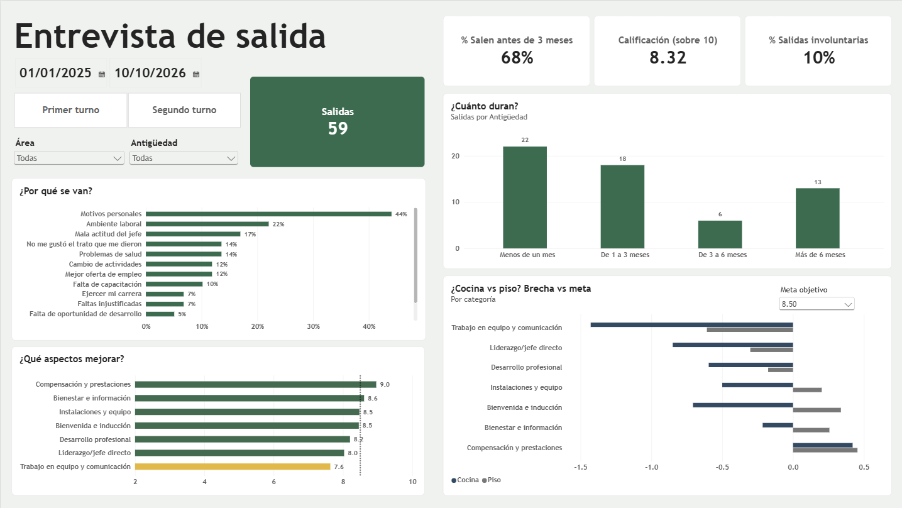
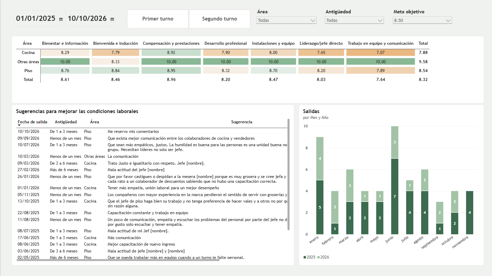
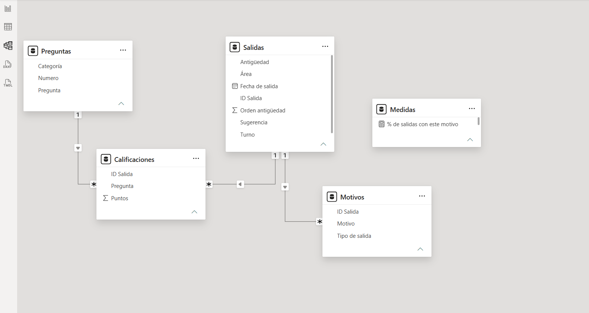

# Exit Interview Dashboard — Power BI

Why are employees leaving a restaurant, how long do they stay, and where should management act first?
Dashboard built from 99 exit interviews (anonymized data from a real client).



## Business questions
1. Why are people leaving?
2. How long do they stay?
3. Which aspects of the job should improve first?
4. Is the problem in the Kitchen or on the Floor?

## Key findings
Analysis period: January 2025 – October 2026 (59 exits). Earlier records were excluded because they are likely incomplete.

- **Turnover happens early:** 68% of exits occur within the first 3 months, and 37% within the first month.
- **It's not about pay:** "better job offer" ranks 6th (12%), and Compensation & benefits is the highest-rated category (9.0 / 10).
- **Climate and supervision matter:** work environment (22%), boss's attitude (17%) and treatment received (14%)
  are among the top reasons, after personal reasons (44%).
- **10% of exits were involuntary** (unexcused absences, intoxication at work).
- **Kitchen vs Floor:** Kitchen scores 7.9 vs 8.5 on the Floor. Against a target of 8/10, Kitchen falls short in
  4 of 7 categories (Teamwork 7.1, Leadership 7.7, Onboarding 7.8, Development 7.9); the Floor only in Teamwork (7.9).
- **Recommendation:** prioritize onboarding and direct supervision in the Kitchen during the first 30–90 days.

## Dashboard features
- **Adjustable target:** a what-if parameter lets the user move the target score; the gap chart
  and the heat map recalculate live.
- **Gap vs target** by category and area, instead of comparing areas against each other.
- **Traffic-light formatting** tied to the target (the heat map colors are based on the gap, not on a fixed value).
- Slicers synced across both pages; the yearly chart ignores the date filter on purpose.



## Data model
Star schema: `Salidas` (one row per exit) filters `Calificaciones` (24 Likert questions, unpivoted)
and `Motivos` (multi-select reasons split into rows). `Preguntas` maps each question to one of 7 categories.



**Power Query:** base query not loaded + reference queries, unpivot, split multi-select answers into rows,
conditional columns for categories, sort order and exit type.

**Key DAX measures:**
```DAX
Salidas = DISTINCTCOUNT(Salidas[ID Salida])

% de salidas con este motivo =
DIVIDE(
    DISTINCTCOUNT(Motivos[ID Salida]),
    CALCULATE([Salidas], REMOVEFILTERS(Motivos[Motivo], Motivos[Tipo de salida]))
)

Calificación (sobre 10) = AVERAGE(Calificaciones[Puntos]) * 2
Brecha vs meta = [Calificación (sobre 10)] - [Meta]
```

## Methodology notes
- Scores converted from a 1–5 scale to a 1–10 scale (×2) for easier reading.
- Areas with fewer than 5 exits are grouped as "Other areas" and excluded from the Kitchen vs Floor comparison.
- Analysis limited to 2025–2026; earlier years are likely incomplete (the form was filled in retroactively).
- Kitchen sample in this period: 21 exits. Differences under ~0.3 points should not be over-interpreted.

## Anonymization
Names, employee numbers and names mentioned in comments were replaced with a Python script
(`scripts/encuesta_salida .py`) before publishing.

## How to open
1. Clone the repo and open `encuesta-salida.pbip` in Power BI Desktop.
2. Update the data source path to `data/entrevista_salida_anonima.xlsx` (Transform data → Source).